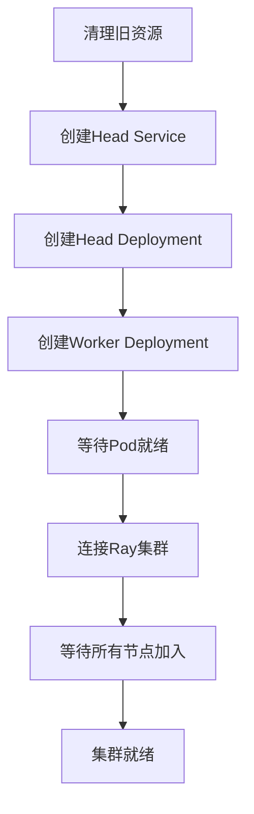
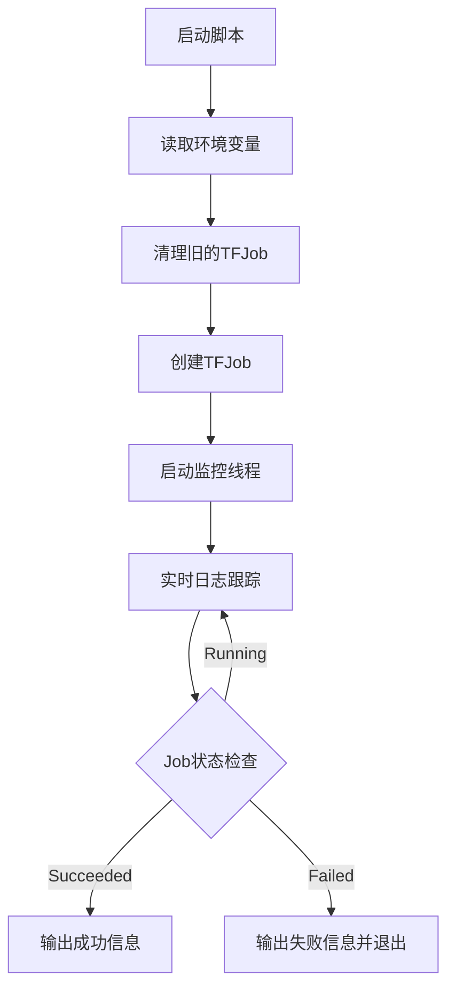

# 1. volcano 有序分布式任务
通过创建 **Volcano Job** CRD（`batch.volcano.sh/v1alpha1`）在平台上发起**多副本分布式计算任务**
## 主要流程
### 1. **环境变量读取**
从环境变量中读取大量配置信息：
- 任务基本信息（ID、名称、项目等）
- 资源限制（CPU、内存、GPU）
- 节点选择器（指定GPU类型等）
- 存储挂载配置
- 镜像仓库密钥
### 2. **Volcano Job创建** (`make_volcanojob`)
构建一个Volcano Job的YAML配置：
- 支持**分布式训练**（通过`num_workers`参数）
- 配置节点亲和性（选择特定GPU节点）
- 支持Pod反亲和性（避免同一节点运行多个Pod）
- 配置资源请求和限制（CPU、内存、GPU）
- 支持**GPU资源**分配（通过`GPU_RESOURCE_NAME`）
### 3. **任务启动** (`launch_volcanojob`)
- 清理旧的同名或同`run-id`的Job
- 创建新的Volcano Job
- **启动监控线程**（`monitoring`）
- **实时日志跟踪**（使用`stern`工具）
### 4. **监控功能** (`monitoring`)
后台线程持续监控：
- 每60秒检查Job状态
- 当Job完成/失败时，终止`stern`日志进程
- 每1小时重启一次日志跟踪（避免长时间运行问题）
### 5. **日志实时输出** (`run_shell`)
使用`stern`命令实时跟踪Pod日志：
- 每小时重启一次`stern`进程
- 实时打印所有Worker Pod的日志
## 分布式训练架构
- 使用Volcano的`Task`定义
- 支持多Worker（通过`num_workers`参数）
- 自动配置Master和Worker角色
## 依赖组件
1. **Volcano**：批处理调度器，支持AI训练任务
2. **Kubernetes API**：通过`py_k8s`模块操作K8s资源
3. **stern**：多Pod日志聚合工具
4. **psutil**：进程管理（用于终止stern进程）
## 转译的yaml内容
根据脚本中的`make_volcanojob`函数,将生成的Volcano Job JSON结构转换为YAML格式：
```yaml
apiVersion: batch.volcano.sh/v1alpha1
kind: Job
metadata:
  namespace: ${KFJ_NAMESPACE}  # 从环境变量获取
  name: ${name}  # 动态生成，格式: volcanojob-${KFJ_PIPELINE_NAME}-${uuid}
  labels:
    run-id: ${KFJ_RUN_ID}
    run-username: ${KFJ_RUNNER}
    pipeline-username: ${KFJ_CREATOR}
    pipeline-id: ${KFJ_PIPELINE_ID}
    pipeline-name: ${KFJ_PIPELINE_NAME}
    task-id: ${KFJ_TASK_ID}
    task-name: ${KFJ_TASK_NAME}
  annotations:
    project: ${KFJ_TASK_PROJECT_NAME}
spec:
  minAvailable: ${num_workers}  # 最小可用副本数
  schedulerName: volcano  # 使用Volcano调度器
  cleanPodPolicy: None  # Pod清理策略
  plugins:
    env: []
    svc: []
    ssh: []
  queue: default  # 使用默认队列
  tasks:
    - replicas: ${num_workers}  # Worker副本数
      name: worker
      template:
        metadata:
          labels:
            pipeline-id: ${KFJ_PIPELINE_ID}
            pipeline-name: ${KFJ_PIPELINE_NAME}
            task-id: ${KFJ_TASK_ID}
            task-name: ${KFJ_TASK_NAME}
            username: ${KFJ_RUNNER}
            component: ${name}
            type: volcanojob
            run-id: ${KFJ_RUN_ID}
          annotations:
            project: ${KFJ_TASK_PROJECT_NAME}
        spec:
          restartPolicy: Never
          volumes: ${k8s_volumes}  # 从KFJ_TASK_VOLUME_MOUNT解析
          imagePullSecrets: ${HUBSECRET}  # 镜像拉取密钥
          affinity:
            nodeAffinity:
              requiredDuringSchedulingIgnoredDuringExecution:
                nodeSelectorTerms:
                  - matchExpressions:
                      # 动态生成，从KFJ_TASK_NODE_SELECTOR解析
                      - key: ${node_selector_key}
                        operator: In
                        values:
                          - ${KFJ_TASK_NODE_SELECTOR[node_selector_key]}
            podAntiAffinity:
              preferredDuringSchedulingIgnoredDuringExecution:
                - weight: 20
                  podAffinityTerm:
                    topologyKey: kubernetes.io/hostname
                    labelSelector:
                      matchLabels:
                        component: ${name}
                        type: volcanojob
          containers:
            - name: volcanojob
              image: ${image}  # 如果未指定则使用KFJ_TASK_IMAGES
              imagePullPolicy: ${IMAGE_PULL_POLICY}  # 默认 IfNotPresent
              workingDir: ${working_dir}  # 工作目录
              env:
                - name: NCCL_DEBUG
                  value: "INFO"
                - name: GPU_NUM
                  value: ${gpu_num}  # GPU数量
                # 如果gpu_num=0，额外添加
                # - name: NVIDIA_VISIBLE_DEVICES
                #   value: "none"
              command:
                - bash
                - -c
                - ${command}  # 实际执行的命令
              volumeMounts: ${k8s_volume_mounts}  # 从KFJ_TASK_VOLUME_MOUNT解析
              resources:
                requests:
                  cpu: ${KFJ_TASK_RESOURCE_CPU}
                  memory: ${KFJ_TASK_RESOURCE_MEMORY}
                  # 如果gpu_num>=1
                  # ${GPU_RESOURCE_NAME}: ${gpu_num}
                  # 如果配置了DEFAULT_POD_RESOURCES
                  # ${DEFAULT_POD_RESOURCES.key}: ${DEFAULT_POD_RESOURCES.value}
                limits:
                  cpu: ${KFJ_TASK_RESOURCE_CPU}
                  memory: ${KFJ_TASK_RESOURCE_MEMORY}
                  # 如果gpu_num>=1
                  # ${GPU_RESOURCE_NAME}: ${gpu_num}
                  # 如果配置了DEFAULT_POD_RESOURCES
                  # ${DEFAULT_POD_RESOURCES.key}: ${DEFAULT_POD_RESOURCES.value}
              # 如果gpu_num==-1，添加
              # securityContext:
              #   privileged: true
```

# 2. ray python的多机分布式任务
基于 [Ray](https://www.ray.io/) 的 Python 多机分布式计算任务模板，用于在 Kubernetes 上按需拉起 Ray 集群并执行用户代码。
## 主要流程
### 1. **环境变量读取**
读取大量配置信息：
- 任务元数据（ID、名称、项目等）
- 资源配置（CPU、内存、GPU）
- 节点选择器、存储挂载、镜像仓库密钥等
### 2. **Ray集群架构**
```text
┌───────────────────────────────────┐
│           Ray 集群                                                           │
│                                                                                    │
│  ┌──────────────────────────────┐      │
│  │  Ray Head (Deployment)                               │      │
│  │  - 1个副本                                                       │      │
│  │  - 服务端口: 6379,10001,8265                        │      │
│  └──────────────────────────────┘      │
│                       │                                                           │
│  ┌────────┴─────────────────────┐      │
│  │                                                                        │      │
│  ▼                                                                      ▼      │
│  ┌──────────────┐    ┌──────────────┐  │
│  │ Ray Worker 1           │    │ Ray Worker N          │  │
│  └──────────────┘    └──────────────┘  │
│   (Deployment, N个副本)                                             │
└───────────────────────────── ──────┘
```
### 3. **关键组件创建**

#### **Head Service** (`create_header_service`)
```yaml
- 类型: ClusterIP Service
- 端口: 
  - 6379: Redis (内部通信)
  - 10001: Ray Client
  - 8265: Ray Dashboard (Web UI)
```
#### **Head Deployment** (`create_header_deploy`)
- 启动Ray Head节点：`ray start --head`
- 自动获取CPU配额（通过`MY_CPU_REQUEST`）
- 暴露监控端口
#### **Worker Deployment** (`create_worker_deploy`)
- 启动N个Worker节点（通过`NUM_WORKER`控制）
- 自动连接到Head节点：`--address=$RAY_HEAD_SERVICE_HOST:6379`
- 支持GPU资源配置
### 4. **GPU支持**
```python
if int(gpu_num)>=1:
    # 分配GPU资源
    worker_deploy['resources']['requests'][GPU_RESOURCE_NAME] = int(gpu_num)
elif int(gpu_num)==-1:
    # 特权模式
    worker_deploy['securityContext'] = {"privileged": True}
else:
    # 禁用GPU
    env: NVIDIA_VISIBLE_DEVICES=none
```
### 5. **集群启动流程** (`launcher_cluster`)

### 6. **任务执行流程** (`__main__`)
1. **解析命令行参数**
    - `--num_worker`: Worker数量
    - `--workdir`: 工作目录
    - `--init`: 初始化脚本（安装依赖）
    - `--command`: 用户任务命令
2. **启动Ray集群**
```python
launcher_cluster(deal='create')
```
3. **执行初始化脚本**（如果指定）
```bash
bash init.sh && ...
```
4. **执行用户任务**
```bash 
cd /workdir && python3 mnist.py
```
5. **清理资源**
```python
launcher_cluster(deal='delete')
```
## 清理机制
脚本在任务完成后会自动删除所有资源，避免资源泄漏。如果中途出错，也会尝试清理已创建的资源。
## 转译的yaml内容
#### 1. Ray Head Service
```yaml
apiVersion: v1
kind: Service
metadata:
  namespace: ${KFJ_NAMESPACE}
  name: ${HEADER_NAME}  # 格式: ray-header-${KFJ_PIPELINE_NAME}-${KFJ_TASK_ID}
  labels:
    run-id: ${KFJ_RUN_ID}
    run-username: ${KFJ_RUNNER}
    pipeline-username: ${KFJ_CREATOR}
    task-id: ${KFJ_TASK_ID}
    pipeline-id: ${KFJ_PIPELINE_ID}
  annotations:
    project: ${KFJ_TASK_PROJECT_NAME}
spec:
  ports:
    - name: client
      protocol: TCP
      port: 10001
      targetPort: 10001
    - name: dashboard
      protocol: TCP
      port: 8265
      targetPort: 8265
    - name: redis
      protocol: TCP
      port: 6379
      targetPort: 6379
  selector:
    component: ${HEADER_NAME}
```
#### 2. Ray Head Deployment
```yaml
apiVersion: apps/v1
kind: Deployment
metadata:
  namespace: ${KFJ_NAMESPACE}
  name: ${HEADER_NAME}  # 格式: ray-header-${KFJ_PIPELINE_NAME}-${KFJ_TASK_ID}
  labels:
    run-id: ${KFJ_RUN_ID}
    run-username: ${KFJ_RUNNER}
    pipeline-username: ${KFJ_CREATOR}
    task-id: ${KFJ_TASK_ID}
    pipeline-id: ${KFJ_PIPELINE_ID}
  annotations:
    project: ${KFJ_TASK_PROJECT_NAME}
spec:
  replicas: 1
  selector:
    matchLabels:
      component: ${HEADER_NAME}
      type: ray
  template:
    metadata:
      labels:
        pipeline-id: ${KFJ_PIPELINE_ID}
        pipeline-name: ${KFJ_PIPELINE_NAME}
        task-name: ${KFJ_TASK_NAME}
        username: ${KFJ_RUNNER}
        component: ${HEADER_NAME}
        type: ray
        run-id: ${KFJ_RUN_ID}
      annotations:
        project: ${KFJ_TASK_PROJECT_NAME}
    spec:
      restartPolicy: Always
      volumes: ${k8s_volumes}  # 从KFJ_TASK_VOLUME_MOUNT解析
      imagePullSecrets: ${HUBSECRET}  # 镜像拉取密钥
      affinity:
        nodeAffinity:
          requiredDuringSchedulingIgnoredDuringExecution:
            nodeSelectorTerms:
              - matchExpressions:
                  # 动态生成，从KFJ_TASK_NODE_SELECTOR解析
                  - key: ${node_selector_key}
                    operator: In
                    values:
                      - ${KFJ_TASK_NODE_SELECTOR[node_selector_key]}
        podAntiAffinity:
          preferredDuringSchedulingIgnoredDuringExecution:
            - weight: 5
              podAffinityTerm:
                topologyKey: kubernetes.io/hostname
                labelSelector:
                  matchLabels:
                    component: ${HEADER_NAME}
                    type: ray
      containers:
        - name: ray-head
          image: ${KFJ_TASK_IMAGES}
          imagePullPolicy: ${IMAGE_PULL_POLICY}  # 默认 IfNotPresent
          workingDir: ${WORKDIR}
          command:
            - /bin/bash
            - -c
            - ${INIT_FILE} ray start --head --port=6379 --num-cpus=$MY_CPU_REQUEST --block
          ports:
            - containerPort: 6379
            - containerPort: 10001
            - containerPort: 8265
          volumeMounts: ${k8s_volume_mounts}
          env:
            - name: MY_CPU_REQUEST
              valueFrom:
                resourceFieldRef:
                  resource: requests.cpu
          resources:
            requests:
              cpu: ${KFJ_TASK_RESOURCE_CPU}
              memory: ${KFJ_TASK_RESOURCE_MEMORY}
              # 如果配置了DEFAULT_POD_RESOURCES
              # ${DEFAULT_POD_RESOURCES.key}: ${DEFAULT_POD_RESOURCES.value}
            limits:
              cpu: ${KFJ_TASK_RESOURCE_CPU}
              memory: ${KFJ_TASK_RESOURCE_MEMORY}
              # 如果配置了DEFAULT_POD_RESOURCES
              # ${DEFAULT_POD_RESOURCES.key}: ${DEFAULT_POD_RESOURCES.value}
```
#### 3. Ray Worker Deployment
```yaml
apiVersion: apps/v1
kind: Deployment
metadata:
  namespace: ${KFJ_NAMESPACE}
  name: ${WORKER_NAME}  # 格式: ray-worker-${KFJ_PIPELINE_NAME}-${KFJ_TASK_ID}
  labels:
    run-id: ${KFJ_RUN_ID}
    run-username: ${KFJ_RUNNER}
    pipeline-username: ${KFJ_CREATOR}
    task-id: ${KFJ_TASK_ID}
    pipeline-id: ${KFJ_PIPELINE_ID}
  annotations:
    project: ${KFJ_TASK_PROJECT_NAME}
spec:
  replicas: ${NUM_WORKER}  # Worker数量
  selector:
    matchLabels:
      component: ${WORKER_NAME}
      type: ray
  template:
    metadata:
      labels:
        pipeline-id: ${KFJ_PIPELINE_ID}
        pipeline-name: ${KFJ_PIPELINE_NAME}
        task-name: ${KFJ_TASK_NAME}
        username: ${KFJ_RUNNER}
        component: ${WORKER_NAME}
        type: ray
        run-id: ${KFJ_RUN_ID}
      annotations:
        project: ${KFJ_TASK_PROJECT_NAME}
    spec:
      affinity:
        nodeAffinity:
          requiredDuringSchedulingIgnoredDuringExecution:
            nodeSelectorTerms:
              - matchExpressions:
                  # 动态生成，从KFJ_TASK_NODE_SELECTOR解析
                  - key: ${node_selector_key}
                    operator: In
                    values:
                      - ${KFJ_TASK_NODE_SELECTOR[node_selector_key]}
        podAntiAffinity:
          preferredDuringSchedulingIgnoredDuringExecution:
            - weight: 5
              podAffinityTerm:
                topologyKey: kubernetes.io/hostname
                labelSelector:
                  matchLabels:
                    component: ${WORKER_NAME}
      imagePullSecrets: ${HUBSECRET}
      restartPolicy: Always
      volumes: ${k8s_volumes}
      containers:
        - name: ray-worker
          image: ${KFJ_TASK_IMAGES}
          imagePullPolicy: ${IMAGE_PULL_POLICY}  # 默认 IfNotPresent
          workingDir: ${WORKDIR}
          command:
            - /bin/bash
            - -c
            - ${INIT_FILE} ray start --num-cpus=$MY_CPU_REQUEST --address=$RAY_HEAD_SERVICE_HOST:6379 --block
          volumeMounts: ${k8s_volume_mounts}
          env:
            - name: MY_CPU_REQUEST
              valueFrom:
                resourceFieldRef:
                  resource: requests.cpu
            - name: RAY_HEAD_SERVICE_HOST
              value: ${HEADER_NAME}
            - name: GPU_NUM
              value: ${gpu_num}
            # 如果gpu_num==0，额外添加
            # - name: NVIDIA_VISIBLE_DEVICES
            #   value: "none"
          resources:
            requests:
              cpu: ${KFJ_TASK_RESOURCE_CPU}
              memory: ${KFJ_TASK_RESOURCE_MEMORY}
              # 如果gpu_num>=1
              # ${GPU_RESOURCE_NAME}: ${gpu_num}
              # 如果配置了DEFAULT_POD_RESOURCES
              # ${DEFAULT_POD_RESOURCES.key}: ${DEFAULT_POD_RESOURCES.value}
            limits:
              cpu: ${KFJ_TASK_RESOURCE_CPU}
              memory: ${KFJ_TASK_RESOURCE_MEMORY}
              # 如果gpu_num>=1
              # ${GPU_RESOURCE_NAME}: ${gpu_num}
              # 如果配置了DEFAULT_POD_RESOURCES
              # ${DEFAULT_POD_RESOURCES.key}: ${DEFAULT_POD_RESOURCES.value}
          # 如果gpu_num==-1，添加
          # securityContext:
          #   privileged: true
```
## 变量说明

| 变量                     | 来源    | 说明                                               |
| ---------------------- | ----- | ------------------------------------------------ |
| `${HEADER_NAME}`       | 自动生成  | `ray-header-${KFJ_PIPELINE_NAME}-${KFJ_TASK_ID}` |
| `${WORKER_NAME}`       | 自动生成  | `ray-worker-${KFJ_PIPELINE_NAME}-${KFJ_TASK_ID}` |
| `${NUM_WORKER}`        | 命令行参数 | Worker副本数                                        |
| `${WORKDIR}`           | 命令行参数 | 工作目录                                             |
| `${INIT_FILE}`         | 命令行参数 | 初始化脚本命令                                          |
| `${gpu_num}`           | 环境变量  | GPU数量                                            |
| `${GPU_RESOURCE_NAME}` | 环境变量  | GPU资源名称（如`nvidia.com/gpu`）                       |

这个YAML定义了一个完整的Ray on Kubernetes部署方案，包含Head节点和Worker节点，支持GPU和分布式计算。

# 3. tf 分布式训练
这是一个用于在**Kubernetes集群**上通过**Kubeflow TFJob**启动分布式TensorFlow训练任务的Python脚本。
## 核心功能
这个脚本是**Kubeflow TFJob启动器**，用于在K8s集群中创建和管理分布式TensorFlow训练任务。
## 主要流程
### 1. **环境变量读取**
与之前的脚本类似，读取大量配置信息：
- 任务元数据（ID、名称、项目等）
- 资源配置（CPU、内存、GPU）
- 节点选择器、存储挂载、镜像仓库密钥等
- **新增**: `SCHEDULER` 环境变量（支持自定义调度器）
### 2. **TFJob创建** (`make_tfjob`)
构建一个Kubeflow TFJob的YAML配置：
```yaml
TFJob结构:
├── metadata (命名空间、名称、标签、注解)
├── spec
│   ├── backoffLimit (重试次数)
│   ├── cleanPodPolicy (Pod清理策略)
│   └── tfReplicaSpecs
│       └── Worker (工作节点配置)
│           ├── replicas (副本数)
│           ├── restartPolicy (重启策略)
│           └── template
│               ├── metadata (标签、注解)
│               └── spec
│                   ├── schedulerName (调度器)
│                   ├── volumes (存储卷)
│                   ├── imagePullSecrets (镜像密钥)
│                   ├── nodeSelector (节点选择)
│                   ├── affinity (亲和性)
│                   └── containers
│                       └── tensorflow (容器配置)
```
### 3. **关键特性**
#### **容器名称要求**
```python
"name": "tensorflow"  # 容器的名称必须是tensorflow
```
这是Kubeflow TFJob的特殊要求，容器名称必须为`tensorflow`。
#### **调度器支持**
```python
schedulerName = os.getenv('SCHEDULER', 'default-scheduler')
```
支持自定义调度器（如Volcano、YuniKorn等）。
### 4. **监控功能** (`monitoring`)
后台线程持续监控：
- 每60秒检查TFJob状态
- 状态包括: `Created`, `Running`, `Succeeded`, `Failed`
- 当Job完成或失败时，终止`stern`日志进程
- 每1小时重启一次日志跟踪
### 5. **日志实时输出** (`run_shell`)
使用`stern`命令实时跟踪所有Worker Pod的日志。
## 完整工作流程

## 转译的yaml内容
#### TFJob YAML结构
```yaml
apiVersion: kubeflow.org/v1
kind: TFJob
metadata:
  namespace: ${KFJ_NAMESPACE}
  name: ${name}  # 格式: tfjob-${KFJ_PIPELINE_NAME}-${uuid}
  labels:
    run-id: ${KFJ_RUN_ID}
    run-username: ${KFJ_RUNNER}
    pipeline-username: ${KFJ_CREATOR}
    pipeline-id: ${KFJ_PIPELINE_ID}
    pipeline-name: ${KFJ_PIPELINE_NAME}
    task-id: ${KFJ_TASK_ID}
    task-name: ${KFJ_TASK_NAME}
  annotations:
    project: ${KFJ_TASK_PROJECT_NAME}
spec:
  backoffLimit: ${num_workers}  # 重试次数
  cleanPodPolicy: None  # Pod清理策略
  tfReplicaSpecs:
    Worker:
      replicas: ${num_workers}  # Worker副本数
      restartPolicy: Never  # 重启策略
      template:
        metadata:
          labels:
            pipeline-id: ${KFJ_PIPELINE_ID}
            pipeline-name: ${KFJ_PIPELINE_NAME}
            task-id: ${KFJ_TASK_ID}
            task-name: ${KFJ_TASK_NAME}
            username: ${KFJ_RUNNER}
            component: ${name}
            type: tfjob
            run-id: ${KFJ_RUN_ID}
          annotations:
            project: ${KFJ_TASK_PROJECT_NAME}
        spec:
          schedulerName: ${SCHEDULER}  # 默认 default-scheduler
          restartPolicy: Never
          volumes: ${k8s_volumes}  # 从KFJ_TASK_VOLUME_MOUNT解析
          imagePullSecrets: ${HUBSECRET}  # 镜像拉取密钥
          nodeSelector: ${KFJ_TASK_NODE_SELECTOR}  # 节点选择器
          affinity:
            podAntiAffinity:
              preferredDuringSchedulingIgnoredDuringExecution:
                - weight: 5
                  podAffinityTerm:
                    topologyKey: kubernetes.io/hostname
                    labelSelector:
                      matchLabels:
                        component: ${name}
                        type: tfjob
          containers:
            - name: tensorflow  # 必须是 tensorflow
              image: ${image}  # 如果未指定则使用KFJ_TASK_IMAGES
              imagePullPolicy: ${IMAGE_PULL_POLICY}  # 默认 IfNotPresent
              workingDir: ${working_dir}
              env:
                - name: GPU_NUM
                  value: ${gpu_num}
                # 如果gpu_num==0，额外添加
                # - name: NVIDIA_VISIBLE_DEVICES
                #   value: "none"
              command:
                - bash
                - -c
                - ${command}
              volumeMounts: ${k8s_volume_mounts}
              resources:
                requests:
                  cpu: ${KFJ_TASK_RESOURCE_CPU}
                  memory: ${KFJ_TASK_RESOURCE_MEMORY}
                  # 如果gpu_num>=1
                  # ${GPU_RESOURCE_NAME}: ${gpu_num}
                  # 如果配置了DEFAULT_POD_RESOURCES
                  # ${DEFAULT_POD_RESOURCES.key}: ${DEFAULT_POD_RESOURCES.value}
                limits:
                  cpu: ${KFJ_TASK_RESOURCE_CPU}
                  memory: ${KFJ_TASK_RESOURCE_MEMORY}
                  # 如果gpu_num>=1
                  # ${GPU_RESOURCE_NAME}: ${gpu_num}
                  # 如果配置了DEFAULT_POD_RESOURCES
                  # ${DEFAULT_POD_RESOURCES.key}: ${DEFAULT_POD_RESOURCES.value}
              # 如果gpu_num==-1，添加
              # securityContext:
              #   privileged: true
```
#### 多Worker分布式训练示例
```yaml
apiVersion: kubeflow.org/v1
kind: TFJob
metadata:
  namespace: kf-training
  name: tfjob-distributed-resnet
  labels:
    run-id: distributed-run-001
    run-username: data-scientist
    pipeline-username: ml-engineer
    pipeline-id: resnet-pipeline
    pipeline-name: resnet-training
    task-id: task-001
    task-name: distributed-training
  annotations:
    project: computer-vision
spec:
  backoffLimit: 5
  cleanPodPolicy: None
  tfReplicaSpecs:
    Worker:
      replicas: 8  # 8个Worker
      restartPolicy: Never
      template:
        metadata:
          labels:
            pipeline-id: resnet-pipeline
            pipeline-name: resnet-training
            task-id: task-001
            task-name: distributed-training
            username: data-scientist
            component: tfjob-distributed-resnet
            type: tfjob
            run-id: distributed-run-001
          annotations:
            project: computer-vision
        spec:
          schedulerName: volcano  # 使用Volcano调度器
          restartPolicy: Never
          volumes:
            - name: data-volume
              persistentVolumeClaim:
                claimName: imagenet-data
            - name: checkpoint-volume
              persistentVolumeClaim:
                claimName: model-checkpoints
          imagePullSecrets:
            - name: docker-registry-secret
          nodeSelector:
            cpu: "true"
            train: "true"
            gpu-type: V100
            accelerator: "nvidia-tesla-v100"
          affinity:
            podAntiAffinity:
              preferredDuringSchedulingIgnoredDuringExecution:
                - weight: 10
                  podAffinityTerm:
                    topologyKey: kubernetes.io/hostname
                    labelSelector:
                      matchLabels:
                        component: tfjob-distributed-resnet
                        type: tfjob
          containers:
            - name: tensorflow
              image: myregistry/tensorflow:2.13.0-gpu-custom
              imagePullPolicy: Always
              workingDir: /workspace
              env:
                - name: GPU_NUM
                  value: "1"
                - name: NCCL_DEBUG
                  value: "INFO"
                - name: NCCL_IB_DISABLE
                  value: "1"
                - name: TF_CPP_MIN_LOG_LEVEL
                  value: "1"
                - name: HOROVOD_CYCLE_TIME
                  value: "0.5"
                - name: HOROVOD_FUSION_THRESHOLD
                  value: "67108864"
              command:
                - bash
                - -c
                - |
                  # 安装依赖
                  pip install -r requirements.txt
                  # 启动训练
                  python3 train.py \
                    --dataset imagenet \
                    --model resnet50 \
                    --batch_size 128 \
                    --epochs 90 \
                    --learning_rate 0.1 \
                    --checkpoint_dir /checkpoints \
                    --log_dir /logs
              volumeMounts:
                - name: data-volume
                  mountPath: /data
                - name: checkpoint-volume
                  mountPath: /checkpoints
              resources:
                requests:
                  cpu: "16"
                  memory: "64Gi"
                  nvidia.com/gpu: 1
                limits:
                  cpu: "16"
                  memory: "64Gi"
                  nvidia.com/gpu: 1
              # 安全上下文（如果gpu_num==-1时需要）
              # securityContext:
              #   privileged: true
```
## 变量说明

|变量|来源|说明|
|---|---|---|
|`${name}`|`default_job_name()`|自动生成：`tfjob-{pipeline_name}-{uuid}`|
|`${num_workers}`|命令行参数|Worker节点数量|
|`${image}`|命令行参数|容器镜像|
|`${working_dir}`|命令行参数|工作目录|
|`${command}`|命令行参数|要执行的命令|
|`${gpu_num}`|环境变量 `KFJ_TASK_RESOURCE_GPU`|GPU数量|
|`${GPU_RESOURCE_NAME}`|环境变量|GPU资源名称（如`nvidia.com/gpu`）|
|`${SCHEDULER}`|环境变量|调度器名称（默认`default-scheduler`）|

## 重要注意事项
1. **容器名称**: 必须是 `tensorflow`（Kubeflow要求）
2. **Worker类型**: 使用 `Worker` 副本类型
3. **自动配置**: Kubeflow会自动注入 `TF_CONFIG` 环境变量
4. **调度器**: 支持自定义调度器（如Volcano、YuniKorn）
5. **GPU资源**: 使用标准的 `nvidia.com/gpu` 资源名称
6. **Pod反亲和**: 自动分散Worker到不同节点
# 4. pytorch 分布式训练
## 核心功能
这个脚本是**Kubeflow PyTorchJob启动器**，专门用于在K8s集群中创建和管理分布式PyTorch训练任务。
## 主要流程
### 1. **环境变量读取**
与之前脚本类似，但增加了RDMA相关支持：
- `RDMA_RESOURCE_NAME`: RDMA资源名称
- `RDMA_RESOURCE`: RDMA资源数量[]()
### 2. **PyTorchJob创建** (`make_pytorchjob`)
构建Kubeflow PyTorchJob的YAML配置：
```yaml
PyTorchJob结构:
├── metadata (命名空间、名称、标签、注解)
├── spec
│   ├── backoffLimit (重试次数)
│   ├── cleanPodPolicy (Pod清理策略)
│   └── pytorchReplicaSpecs
│       ├── Master (主节点)
│       │   └── replicas: 1 (固定为1)
│       └── Worker (工作节点)
│           └── replicas: num_workers - 1
```
### 3. **关键特性**
#### **Master-Worker架构**
```python
pod_spec = {
    "replicas": 1,  # Master固定为1
    # ... 配置
}

worker_pod_spec = copy.deepcopy(pod_spec)
worker_pod_spec['replicas'] = int(num_workers) - 1  # Worker = 总数 - 1
```
PyTorchJob使用**Master-Worker架构**：
- **1个Master**: 负责任务协调
- **N-1个Worker**: 执行实际训练
- 总共 `num_workers` 个节点
#### **GPU支持**
### 4. **监控功能** (`monitoring`)
后台线程持续监控：
- 每60秒检查PyTorchJob状态
- 状态包括: `Created`, `Running`, `Succeeded`, `Failed`
- 当Job完成或失败时，终止`stern`日志进程
- 每1小时重启一次日志跟踪
### 5. **日志实时输出**
使用`stern`命令，排除`init-pytorch`容器：
```bash
stern pytorchjob-xxx --exclude-container init-pytorch --since 10s
```
这个模式和我们现有的 master-worker 工作模式差不多

# 5. deploy-service 任务
## 核心功能
这是一个**Kubeflow模型服务部署脚本**，用于通过API接口在Kubeflow平台（或相关Dashboard）上部署/更新推理服务（InferenceService）。
## 主要流程
```text
1. 解析命令行参数
2. 验证项目组是否存在
3. 检查同名服务是否存在
4. 创建新服务 或 更新已有服务
5. 触发实际部署（deploy/prod）
6. 返回部署结果
```
## 完整工作流程
### 第1步：参数解析
通过`argparse`接收20+个部署参数，包括项目组、模型名、资源配额、镜像、环境变量等。
### 第2步：权限认证
从环境变量获取`SECRET`（或`KFJ_CREATOR`），作为API请求的`Authorization`头。
### 第3步：项目组验证
- 调用`/project_modelview/api/`接口查询指定`project_name`是否存在
- 若不存在，脚本退出
### 第4步：服务存在性检查
- 使用`model_name` + `model_version`作为唯一键查询现有服务
- 若查询失败（非200），直接退出
### 第5步：创建或更新
- **服务不存在**：`POST /inferenceservice_modelview/api/` 创建新服务
- **服务已存在**：`PUT /inferenceservice_modelview/api/{id}` 更新服务
### 第6步：触发部署
- 等待5秒（等待数据库同步）
- 调用`GET /inferenceservice_modelview/api/deploy/prod/{id}`触发实际部署
- 状态码为`302`或`200`表示成功，否则失败
## 转译的YAML内容
脚本最终会构建一个`payload`字典，等价于以下YAML结构的部署配置：
```yaml
apiVersion: v1
kind: InferenceService
metadata:
  name: <model_name>-<model_version>  # 由模型名+版本号组合
  namespace: <project_name>
  labels:
    project: <project_id>             # 项目组ID
    label: <label>                    # 服务中文名
spec:
  # 基础配置
  model_name: <model_name>
  model_version: <model_version>
  model_path: <model_path>            # 模型存储路径
  images: <images>                    # 容器镜像
  working_dir: <working_dir>          # 工作目录
  command: <command>                  # 启动命令
  args: <args>                        # 启动参数
  env: <env>                          # 环境变量
  
  # 资源配置
  resource_memory: <resource_memory>  # 内存，如 "2G"
  resource_cpu: <resource_cpu>        # CPU核心，如 "2"
  resource_gpu: <resource_gpu>        # GPU数量，如 "0"
  
  # 弹性伸缩
  min_replicas: <replicas>            # 最小副本数
  max_replicas: <replicas>            # 最大副本数
  hpa: <hpa>                          # HPA配置
  
  # 网络配置
  ports: <ports>                      # 端口号，如 "80"
  host: <host>                        # 域名
  service_type: <service_type>        # 服务类型，默认 "serving"
  
  # 其他配置
  volume_mount: <volume_mount>        # 存储卷挂载
  inference_config: <inference_config> # 推理配置文件
  metrics: <metrics>                  # 监控指标
  health: <health>                    # 健康检查配置
```
## 变量说明
### 环境变量（从os.getenv读取）

|变量|用途|默认值|
|---|---|---|
|`SECRET` / `KFJ_CREATOR`|API认证密钥|`'admin'`|
|`HOST` / `KFJ_MODEL_REPO_API_URL`|API服务地址|`'http://kubeflow-dashboard.infra'`|

### 命令行参数（核心字段）

|参数|说明|默认值|
|---|---|---|
|`--project_name`|所属项目组|`'public'`|
|`--service_type`|服务类型|`'serving'`|
|`--label`|服务中文名|`'演示服务'`|
|`--model_name`|模型名称（唯一键之一）|`'demo'`|
|`--model_version`|模型版本号（唯一键之一）|`'vY.m.d.1'`（当前日期）|
|`--model_path`|模型文件路径|`''`|
|`--images`|容器镜像|`'nginx'`|
|`--resource_memory`|内存限制|`'2G'`|
|`--resource_cpu`|CPU核心数|`'2'`|
|`--resource_gpu`|GPU数量|`'0'`|
|`--replicas`|副本数（min=max）|`'1'`|
|`--host`|域名|`''`|
|`--command`|容器启动命令|`''`|
|`--args`|启动参数|`''`|
|`--working_dir`|工作目录|`''`|
|`--env`|环境变量（JSON格式）|`''`|
|`--hpa`|弹性伸缩配置|`''`|
|`--ports`|容器端口|`'80'`|
|`--volume_mount`|存储挂载配置|`''`|
|`--inference_config`|推理配置|`''`|
|`--metrics`|监控指标配置|`''`|
|`--health`|健康检查配置|`''`|
## 关键设计特点
1. **幂等性**：通过`model_name`+`model_version`判断，支持重复执行（创建/更新）
2. **项目隔离**：服务必须归属于某个已有项目组
3. **两阶段部署**：先写入数据库（POST/PUT），再触发实际部署（GET deploy）
4. **`@pysnooper`调试**：装饰器会输出详细日志，方便排查问题
# 6. 模型离线分布式推理 模板
## 核心功能
这三个脚本共同构成一个**基于Volcano的分布式离线推理系统**，利用RabbitMQ作为任务队列，实现数据并行处理。

|脚本|角色|核心功能|
|---|---|---|
|**脚本1**（volcanojob launcher）|**调度器/控制器**|创建Volcano Job、管理RabbitMQ Pod/Service、监控任务状态|
|**脚本2**（RabbitMQ客户端库）|**消息队列SDK**|提供生产者/消费者/管理API，实现分布式任务分发|
|**脚本3**（用户推理代码）|**业务逻辑**|继承基类实现数据源和推理逻辑，自动适配分布式环境|
## 主要流程
```text
1. 解析环境变量（KFJ_*系列）
2. 读取K8s配置（Volume Mount、Node Selector、GPU/RDMA资源）
3. 创建/重建RabbitMQ Pod + Service
4. 构建Volcano Job CRD（支持多Worker）
5. 启动监控线程（实时跟踪日志、检查队列消费状态）
6. 任务完成后清理资源
```
## 完整工作流程
```text
1. 初始化K8s客户端，获取命名空间、任务ID、项目名等环境变量
2. 解析节点选择器（cpu=true,train=true）和GPU/RDMA资源
3. 删除旧RabbitMQ → 创建新RabbitMQ（Pod + Service）
4. 生成Volcano Job名称（volcanojob-{pipeline}-{uuid}）
5. 构建Volcano Job JSON：
   - 设置副本数（num_workers）
   - 配置容器（镜像、命令、环境变量、资源限制）
   - 设置节点亲和性 + Pod反亲和性
   - 配置Volcano策略（TaskCompleted→CompleteJob, PodFailed→AbortJob）
6. 提交Volcano Job到K8s集群
7. 启动监控线程：
   a. 实时打印Pod日志（使用stern）
   b. 每60秒检查RabbitMQ队列剩余消息数
   c. 检测Volcano Job状态（Completed/Failed）
   d. 若队列为空且连续两次检测为0，主动终止任务
8. 等待任务完成，清理RabbitMQ和Volcano Job
```
## 转译的YAML内容（Volcano Job）
```yaml
apiVersion: batch.volcano.sh/v1alpha1
kind: Job
metadata:
  namespace: <KFJ_NAMESPACE>
  name: volcanojob-<pipeline>-<uuid>
  labels:
    run-id: <KFJ_RUN_ID>
    run-username: <KFJ_RUNNER>
    pipeline-username: <KFJ_CREATOR>
    pipeline-id: <KFJ_PIPELINE_ID>
    pipeline-name: <KFJ_PIPELINE_NAME>
    task-id: <KFJ_TASK_ID>
    task-name: <KFJ_TASK_NAME>
  annotations:
    project: <KFJ_TASK_PROJECT_NAME>
spec:
  minAvailable: <num_workers>          # 最小可用Pod数
  schedulerName: volcano
  cleanPodPolicy: None
  queue: default
  plugins:
    env: []
    svc: []
    ssh: []
  policies:
    - event: PodFailed
      action: AbortJob
  tasks:
    - replicas: <num_workers>
      name: worker
      policies:
        - event: TaskCompleted
          action: CompleteJob
        - event: PodFailed
          action: AbortJob
      template:
        metadata:
          labels:
            pipeline-id: <KFJ_PIPELINE_ID>
            pipeline-name: <KFJ_PIPELINE_NAME>
            task-id: <KFJ_TASK_ID>
            task-name: <KFJ_TASK_NAME>
            username: <KFJ_RUNNER>
            component: <job_name>
            type: volcanojob
            run-id: <KFJ_RUN_ID>
          annotations:
            project: <KFJ_TASK_PROJECT_NAME>
        spec:
          restartPolicy: Never
          volumes: <k8s_volumes>        # 从KFJ_TASK_VOLUME_MOUNT解析
          imagePullSecrets: [hubsecret]
          affinity:
            nodeAffinity:
              requiredDuringSchedulingIgnoredDuringExecution:
                nodeSelectorTerms:
                  - matchExpressions:
                      - key: cpu
                        operator: In
                        values: ["true"]
                      - key: train
                        operator: In
                        values: ["true"]
                      # 若有GPU，自动添加 gpu-type: <gpu_type>
            podAntiAffinity:
              preferredDuringSchedulingIgnoredDuringExecution:
                - weight: 20
                  podAffinityTerm:
                    topologyKey: kubernetes.io/hostname
                    labelSelector:
                      matchLabels:
                        component: <job_name>
                        type: volcanojob
          containers:
            - name: volcanojob
              image: <image>
              imagePullPolicy: IfNotPresent
              workingDir: <working_dir>
              command: ["bash", "-c", "<command>"]
              env:
                - name: RABBIT_HOST
                  value: rabbitmq-<pipeline>
              volumeMounts: <k8s_volume_mounts>
              resources:
                requests:
                  cpu: <KFJ_TASK_RESOURCE_CPU>
                  memory: <KFJ_TASK_RESOURCE_MEMORY>
                  # 若有GPU: <GPU_RESOURCE_NAME>: <gpu_num>
                limits:
                  cpu: <KFJ_TASK_RESOURCE_CPU>
                  memory: <KFJ_TASK_RESOURCE_MEMORY>
                  # 若有GPU: <GPU_RESOURCE_NAME>: <gpu_num>
```

## 关键变量说明
### 脚本1

|环境变量|用途|默认值|
|---|---|---|
|`KFJ_NAMESPACE`|K8s命名空间|`''`|
|`KFJ_TASK_ID`|任务唯一ID|`''`|
|`KFJ_TASK_NAME`|任务名称|`''`|
|`KFJ_PIPELINE_ID`|流水线ID|`''`|
|`KFJ_PIPELINE_NAME`|流水线名称|`''`|
|`KFJ_RUN_ID`|运行ID（用于清理旧任务）|`''`|
|`KFJ_RUNNER`|执行人|`''`|
|`KFJ_CREATOR`|创建人|`''`|
|`KFJ_TASK_PROJECT_NAME`|项目组|`'public'`|
|`KFJ_TASK_IMAGES`|任务镜像|`''`|
|`KFJ_TASK_VOLUME_MOUNT`|存储挂载配置|`''`|
|`KFJ_TASK_RESOURCE_CPU`|CPU配额|`''`|
|`KFJ_TASK_RESOURCE_MEMORY`|内存配额|`''`|
|`KFJ_TASK_RESOURCE_GPU`|GPU数量|`'0'`|
|`KFJ_TASK_NODE_SELECTOR`|节点选择器|`'cpu=true,train=true'`|
|`GPU_RESOURCE_NAME`|GPU资源名称（如[nvidia.com/gpu](https://nvidia.com/gpu)）|`''`|
|`RABBITMQ_IMAGE`|RabbitMQ镜像|`'rabbitmq:3.9.12-management'`|
### 脚本2：RabbitMQ客户端库
#### 核心类

|类名|功能|
|---|---|
|`Rabbit_Producer`|生产者：发送消息到Exchange|
|`Rabbit_Consumer`|消费者：从Queue接收消息|
|`Rabbit_info`|管理API：查询队列状态、消息数量|
### 工作流程
```text
生产者流程：
1. 连接RabbitMQ（host/port/user/password）
2. 声明Exchange（topic类型，持久化）
3. 发送消息（指定routing_key）

消费者流程：
1. 连接RabbitMQ
2. 声明Exchange + Queue
3. Queue绑定到Exchange（routing_key）
4. 注册回调函数，开始消费（auto_ack配置）

管理API流程：
1. HTTP请求RabbitMQ管理接口（15672端口）
2. 获取队列信息、消息数量等
```

### 脚本3：用户推理代码
#### 核心架构
```python
class My_Offline_Predict(Offline_Predict):
    def __init__(self):
        # 加载模型（TF SavedModel）
        self.model = tf.saved_model.load('/mnt/admin/ray/ori/')
    
    def datasource(self):
        # 返回所有待处理数据路径列表
        return open('/mnt/admin/ray/aa.txt').readlines()
    
    def predict(self, value):
        # 单条数据处理逻辑
        feats_npy = numpy.load(value)
        return self.model(feats_npy)

My_Offline_Predict().run()
```

## 自动分布式调度逻辑（OfflinePredict.run/start_predict）
```text
判断是否在Volcano分布式环境（VC_TASK_INDEX存在）：
├── 本地模式（无VC_TASK_INDEX）
│   └── 单线程顺序处理所有数据
│
└── 分布式模式（有VC_TASK_INDEX）
    ├── 创建RabbitMQ队列（所有Worker执行）
    ├── Worker 0（VC_TASK_INDEX=0 && LOCAL_RANK=0）
    │   ├── 生产者模式：读取数据源，全部发送到RabbitMQ
    │   └── 等待队列消费完毕（wait_finish）
    ├── 其他Worker（VC_TASK_INDEX>0）
    │   └── 消费者模式：从RabbitMQ拉取消息，执行predict
    └── 队列为空时自动结束
```

## 系统完整工作流程
```text
┌─────────────────────────────────────────────────────────────────────┐
│  1. 用户提交离线推理任务（通过Kubeflow Pipeline）                    │
└─────────────────────────────────────────────────────────────────────┘
                                    ↓
┌─────────────────────────────────────────────────────────────────────┐
│  2. 脚本1（Volcano Job Launcher）启动                              │
│     - 读取KFJ_*环境变量                                            │
│     - 解析Volume Mount、Node Selector、GPU配置                    │
└─────────────────────────────────────────────────────────────────────┘
                                    ↓
┌─────────────────────────────────────────────────────────────────────┐
│  3. 创建RabbitMQ（Pod + Service）                                  │
│     - Pod名称: rabbitmq-{pipeline}                                │
│     - Service暴露5672（AMQP）和15672（管理API）                   │
└─────────────────────────────────────────────────────────────────────┘
                                    ↓
┌─────────────────────────────────────────────────────────────────────┐
│  4. 创建Volcano Job                                               │
│     - num_workers个Pod（由Volcano调度）                           │
│     - 每个Pod注入环境变量：RABBIT_HOST=rabbitmq-{pipeline}        │
│     - 设置节点亲和性 + Pod反亲和性                                │
└─────────────────────────────────────────────────────────────────────┘
                                    ↓
┌─────────────────────────────────────────────────────────────────────┐
│  5. 各Worker Pod启动，执行脚本3                                   │
│     - Worker 0: 读取数据 → 发送到RabbitMQ                        │
│     - Worker 1~N: 从RabbitMQ拉取数据 → 加载模型 → 推理          │
└─────────────────────────────────────────────────────────────────────┘
                                    ↓
┌─────────────────────────────────────────────────────────────────────┐
│  6. 监控线程（脚本1）                                             │
│     - 实时打印所有Pod日志（stern）                                │
│     - 每60秒检查RabbitMQ队列剩余消息                              │
│     - 队列为空且连续两次检测为0 → 主动终止任务                   │
│     - 检测Volcano Job状态（Completed/Failed）                     │
└─────────────────────────────────────────────────────────────────────┘
                                    ↓
┌─────────────────────────────────────────────────────────────────────┐
│  7. 任务结束，清理资源                                            │
│     - 删除RabbitMQ Pod + Service                                  │
│     - 删除Volcano Job（按run-id）                                 │
│     - 若任务Failed，退出码1                                       │
└─────────────────────────────────────────────────────────────────────┘
```
## 分布式协调关键机制

|机制|实现方式|
|---|---|
|**任务分发**|Worker 0作为生产者，将数据全部推入RabbitMQ|
|**负载均衡**|RabbitMQ自动将消息分发给各消费者Worker|
|**任务完成检测**|监控线程每60秒检查队列剩余消息数，连续两次为0则判定完成|
|**容错**|Volcano策略：PodFailed → AbortJob；TaskCompleted → CompleteJob|
|**资源调度**|Volcano调度器 + 节点亲和性 + GPU/RDMA资源配置|
|**日志追踪**|stern实时跟踪所有Pod日志|
## 环境变量传递链
```text
Pipeline触发 → 设置KFJ_*环境变量 → 脚本1读取 → 
  创建Volcano Job时注入 → Worker Pod继承环境变量 → 
  脚本3通过os.environ读取 → 判断角色（生产者/消费者）
```

# 7. 注册模型
## 核心功能
这是一个**模型注册脚本**，用于将训练好的模型注册到Kubeflow Dashboard的模型仓库中，便于后续部署推理服务。
## 主要流程
```text
1. 解析命令行参数（模型名、版本、路径、指标等）
2. 验证项目组是否存在
3. 检查同名+同run_id的模型是否已注册
4. 创建新模型记录 或 更新已有记录
5. 返回注册结果
```
## 完整工作流程
### 第1步：参数解析
接收8个命令行参数，包括模型名称、版本、路径、框架、指标等。
### 第2步：权限认证
从环境变量获取`SECRET`（或`KFJ_CREATOR`），作为API请求的`Authorization`头。
### 第3步：项目组验证
- 调用`/project_modelview/api/`接口查询指定`project_name`是否存在
- 若不存在，脚本退出
### 第4步：模型存在性检查
- 使用`model_name` + `run_id`（来自环境变量`KFJ_RUN_ID`）作为联合查询条件
- 查询`/training_model_modelview/api/`接口
- 若查询失败（非200），直接退出
### 第5步：创建或更新模型记录
- **不存在**：`POST /training_model_modelview/api/` 创建新记录
- **已存在**：`PUT /training_model_modelview/api/{id}` 更新记录
### 第6步：输出结果
- 成功：打印"注册成功"或"更新成功"
- 失败：打印错误信息并`exit(1)`
## 转译的YAML内容（模型注册信息）
脚本构建的`payload`字典等价于以下YAML结构：
```yaml
apiVersion: v1
kind: Model
metadata:
  name: <model_name>
  version: <model_version>
  project: <project_id>
  run_id: <KFJ_RUN_ID>
  pipeline_id: <KFJ_PIPELINE_ID>
spec:
  path: <model_path>                    # 模型存储路径
  describe: <describe>                  # 模型描述
  framework: <framework>                # 算法框架（如tf/pytorch）
  inference_framework: <inference_framework>  # 推理框架（如tfserving）
  metrics: <model_metric>               # 模型评估指标（JSON格式）
  md5: ""                               # 文件MD5（预留字段）
  run_time: <当前时间>                  # 注册时间
```
## 变量说明
### 环境变量（从os.getenv读取）

|变量|用途|默认值|
|---|---|---|
|`SECRET` / `KFJ_CREATOR`|API认证密钥|`'admin'`|
|`KFJ_TASK_PROJECT_NAME`|项目组名称（可覆盖--project_name）|`'public'`|
|`KFJ_RUN_ID`|运行ID（用于关联同一任务）|`''`|
|`KFJ_PIPELINE_ID`|流水线ID|`'0'`|
|`HOST` / `KFJ_MODEL_REPO_API_URL`|API服务地址|`'http://kubeflow-dashboard.infra'`|

### 命令行参数

|参数|说明|默认值|
|---|---|---|
|`--project_name`|所属项目组|`'public'`|
|`--model_name`|模型名称（唯一键之一）|`'demo'`|
|`--model_version`|模型版本号|`'vY.m.d.1'`（当前日期）|
|`--model_path`|模型存储路径|`''`|
|`--model_metric`|模型评估指标（JSON字符串）|`''`|
|`--describe`|模型中文描述|`'xx模型'`|
|`--framework`|训练框架|`'tf'`|
|`--inference_framework`|推理框架|`'tfserving'`|

### Payload中的自动生成字段

|字段|来源/计算方式|
|---|---|
|`project`|通过`project_name`查询得到项目ID|
|`run_id`|环境变量`KFJ_RUN_ID`|
|`pipeline_id`|环境变量`KFJ_PIPELINE_ID`|
|`run_time`|`datetime.datetime.now().strftime('%Y.%m.%d %H:%M:%S')`|
|`md5`|固定为空字符串（预留）|
## 关键设计特点
1. **幂等性**：通过`model_name` + `run_id`联合查询，支持重复执行（创建/更新）
2. **项目隔离**：模型必须归属于已有项目组
3. **可追溯性**：记录`run_id`、`pipeline_id`、`run_time`，便于关联训练任务
4. **双框架标识**：同时记录训练框架（`framework`）和推理框架（`inference_framework`）
## 与训练流水线的集成
```text
训练流水线执行 → 设置KFJ_RUN_ID, KFJ_PIPELINE_ID, KFJ_TASK_PROJECT_NAME
                                    ↓
                           模型训练完成
                                    ↓
                   本脚本执行（作为流水线最后一个步骤）
                                    ↓
                    模型信息注册到Dashboard
                                    ↓
                    可用于后续推理服务部署
```
