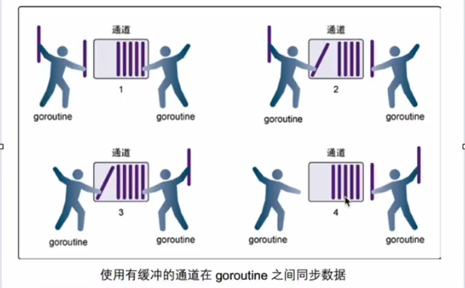

## 一. go 环境的安装
### 1. 源码包下载地址
1. [下载地址 ](http://golang.org/dl/)
2. [中文网址](http://studygolang.com/dl/)
### 2. 安装指令
```bash
cd ~/.下载
# 下载指令
curl https://go.dev/dl/go1.27.0.linux-amd64.tar.gz
# 直接解压到 /usr/local/ 下面去了
sudo tar -zxvf go1.27.0.linux-amd64.tar.gz -C /usr/local
# go 所有内容安装路径
cd /usr/local/go
# go 包结构,含一些源码
tree /usr/local/go -L 1
/usr/local/go/cmd # 命令行解析源码
/usr/local/go/sort # 排序源码
# 编译器路径
/usr/local/go/bin/go
```
### 3. 环境变量设置
```bash
vim ~/.bashrc
# 添加以下几行
export GOROOT=/usr/local/go # 源码包所子路径
export GOPATH=$HOME/go     # 当前用户写 go 语言开发者写 go 代码的开发路径, 项目默认环境变量
export PATH=$PATH:$GOROOT/bin:$GOPATH/bin
# 重新加载环境变量
source ~/.bashrc
# 检测 go 环境
go --version
go --help
```
### 4. 编辑器
1. Goland                                    收费
2. vscode(个人倾向)                   免费
3. vim + go插件
## 二. go 语言的特性
### 1. 优势
#### 极简的部署方式
- 可以直接编译成机器码
- 编译出来的机器码不依赖其他库          静态编译
- 直接运行即可部署
#### 静态类型语言
- 编译的时候检查出来隐藏的大多数问题
#### 语言层面的并发
- 天生的基因支持
- 充分利用多核
```go
package main

import (
    "fmt"
    "time"
)

fun goFun(int i){
    fmt.Println("goroutin", i, "....")
}

fun main(){
    for i:= 0; i < 100000; i++ {
        go goFun(i)    // 开启一个并发协程, 语言原生支持关键字 go
    }
    time.Sleep(time.Second)
}
```
#### 强大的标准库
- runtime 系统调度机制
- 高效的 GC 垃圾回收
- 丰富的标准库
#### 易学
- 25 个关键字
- c 语言简洁基因, 内嵌 C 语法支持
- 面向对象特征(继承, 多态, 封装)
- 跨平台
![[总体结构-1787195983830.webp|517]]
### 2. 劣势
- 无包管理, 大部分的包都在 github 上
- 无泛化类型
- 所有的 **Exception** 都用 **Error** 来处理
- 对 C 的降级处理, 并非无缝, 没有 C 降级到 asm 那么完美(序列化问题)
### 3. 比较重要的开发项目
- docker
- k8s
## 三. golang 语法新奇
### 1. go 常用指令
```bash
# 环境
go version            # 当前版本
go env                # 所有环境变量
go env GOPATH         # 查单个(如 GOMODCACHE/GOBIN)
go env -w GOFLAGS=-mod=mod   # 持久改配置(写进 go env 文件)
go env -u GOFLAGS     # 撤销某项
go env -w GOMODCACHE=/path   # 改依赖缓存位置

# 依赖 / 模块(现代 Go 都用 go.mod)
go mod init github.com/you/xxx   # 初始化模块
go mod tidy           # 自动整理 go.mod/go.sum(加缺失、删多余)
go get github.com/gin-gonic/gin@v1.9.1  # 加/升级某依赖
go get -u ./...       # 升级所有依赖
go mod vendor         # 打包依赖到 vendor/ 目录
go list -m all        # 列出当前模块及所有依赖

# 构建 / 运行
go build              # 编译当前模块(生成二进制)
go build -o out/app . # 指定输出文件名
go run main.go        # 直接跑(不产出二进制)
go run .              # 跑当前目录
go test ./...         # 跑所有测试
go test -v ./...      # 详细输出
go test -run TestXxx ./pkg   # 只跑匹配的测试
go vet ./...          # 静态检查
go fmt ./...          # 格式化(等价 goimports 基础)
go install ./...      # 编译装到 GOBIN

# 清理 / 诊断
go clean -cache       # 清构建缓存(GOCACHE)
go clean -modcache    # 清模块缓存(GOMODCACHE)
go clean -test        # 清测试临时文件
go work init          # 多模块工作区(进阶)
```
### 2. 项目结构
```bash
bin                       # 编译之后的二进制文件存放路径
pkg                      # 依赖的第三方库或者自己写的库
src                        # 源码
```
### 3. go 代码的结构
```go
package main

import "fmt"

func main(){
    fmt.Println("hello go!");
}
```
### 4. 变量声明
#### 4.1 局部变量声明
```go
// 方法一: 声明一个变量 默认值是 0
var a int
fmt.Println("a = ", a)
fmt.Printf("type of a = %T\n", a)
// 方法二: 声明一个变量, 初始化一个值
var b int = 100
fmt.Println("b = ", b)
fmt.Printf("type of b = %T\n", b)
// 方法三: 在初始化的时候, 可以省去数据类型, 通过值自动匹配当前的变量的数据类型
var c = 100
fmt.Println("c = ", c)
fmt.Printf("type of c = %T\n", c)
// 方法四: (常用的方法) 省去关键字 var, 直接自动匹配
e := 100
fmt.Println("e = ", e)
fmt.Printf("type of e = %T\n", e)
```
#### 4.2 全局变量声明
  **方法四不支持**
#### 4.3 多变量的声明
```go
// 声明多个变量
var x, y int = 100, 200
var x1, y1 = 300, "test"
x2, y2 := 400, "test1"
// 多行变量声明
var (
    x3 int = 500
    y3 bool = true
)
```
### 5.常量与 iota
#### 5.1 常量
```go
const (
    // 可以在 const() 添加一个关键字 iota, 每行的 iota 都会累加1, 第一行的 iota 的默认值
    // START = 0
    // STOP = 1
    // PENDING = 2
    // 上下等价
    START = iota   // iota = 0
    STOP               // iota = 1
    PENDING        // iota = 2
)
const (
	Monday    = 10 * iota // iota = 0, Monday = 0
	Tuesday               // iota = 1, Tuesday = 10
	Wednesday             // iota = 2, Wednesday = 20
	Thursday              // iota = 3, Thursday = 30
	Friday                // iota = 4, Friday = 40
	Saturday              // iota = 5, Saturday = 50
	Sunday                // iota = 6, Sunday = 60
)
```
#### 5.2 与 const 来表示枚举类型
```go
const (
	a, b = iota + 1, iota + 2 // iota = 0, a = 1, b = 2
	c, d                      // iota = 1, c = 2, d = 3
	e, f                      // iota = 2, e = 3, f = 4

	g, h = iota * 2, iota * 3 // iota = 3, g = 6, h = 9
	i, j                      // iota = 4, i = 8, j = 12
)
```
### 6. 函数
#### 6.1 多返回值
- 返回多个返回值, 匿名的
```go
// 返回多个返回值, 匿名的
func add2(a, b int) (int, int, int) {
	return a, b, a + b
}
```
- 返回多个 返回值, 命名的
```go
// 返回多个返回值, 命名的
func add3(a, b int) (x, y, sum int) {
	x = a
	y = b
	sum = a + b
	return
}
```
#### 6.2 init 函数和 import 导包
- 导包堆栈
![[总体结构-1787293806786.webp]]
- 项目堆栈
```go
.
├── go.mod
├── lib1
│   └── lib1.go
├── lib2
│   └── lib2.go
└── main.go
```
- main.go 结构
```go
package main

import (
	"fmt"

	"golangstudy/5-init/lib1"
	"golangstudy/5-init/lib2"
)

func main() {
	fmt.Println("This is main function...")
	lib1.Lib1Func()
	lib2.Lib2Func()
}
```
- 输出结果
```bash
zhoujun@ubuntu:~/文档/code/backend/go/GolangStudy/5-init$ go run main.go 
lib1 init() function...
lib2 init() function...
This is main function...
This is lib1 function...
This is lib2 function...
```
- import 导包, 匿名, 触发 init 函数, 不能使用包函数
```go
import _ "golangstudy/5-init/lib1"
```
- import 导包, 别名
```go
import mylib "golangstudy/5-init/lib1"
// 使用方法就是
mylib.funct1()
```
- import 这样导包可以直接使用函数
```go
import . "golangstudy/5-init/lib1"
funct1()
```
### 7. go 指针
![[总体结构-1787296984338.webp]]
```go
package main

import "fmt"

func swap(a, b *int) {
	*a, *b = *b, *a
}

func main() {
	a := 10
	b := 20
	fmt.Println("a:", a, "b:", b)
	swap(&a, &b)
	fmt.Println("a:", a, "b:", b)
}
```
### 8. defer
![[总体结构-1787298085023.webp]]
简单的来说就是 go 的析构函数
```go
package main
import fmt
func main(){
    defer fmt.Println("main::end1")
    defer fmt.Println("main::end2")
    
     fmt.Println("main::print1")
     fmt.Println("main::print2")
}
```
打印的内容是
```bash
zhoujun@ubuntu:~/文档/code/backend/go/GolangStudy$ go run 7-defer/test-defer.go 
main::print1
main::print2
main::end2
main::end1
# 压栈, 堆栈输出
```
**需要注意的是:** return 在 defer 前面, 先 return 后 defer
### 9. go中的数组和动态数组
- 固定长度的数组
```go
package main

import "fmt"

func range_list(the_array [10]int) {
	// 这里是死拷贝,非常消耗内存,所以在实际开发中,不建议使用数组作为函数参数
	for index, value := range the_array {
		fmt.Println(index, value)
	}
}

func main() {
	var arr [3]int
	var arr2 [3]int = [3]int{1, 2, 3}
	var arr3 = [3]int{1, 2, 3}
	arr4 := [3]int{1, 2, 3}
	arr5 := [10]int{1, 2, 3, 4, 5, 6, 7, 8, 9, 10}

	fmt.Println(arr)
	fmt.Println(arr2)
	fmt.Println(arr3)
	fmt.Println(arr4)

	// 遍历方法
	for i := 0; i < len(arr4); i++ {
		fmt.Println(arr4[i])
	}

	for index, value := range arr4 {
		fmt.Println(index, value)
	}

	range_list(arr5)
	// range_list(arr2) // 这样是不行的 3 类型的数组不能传给 10 类型的数组,因为数组的长度也是类型的一部分
}
```
- 动态数组,切片
```go
package main

import "fmt"

func printSlice(the_slice []int) {
	// 引用传递,不会消耗内存,所以在实际开发中,建议使用切片作为函数参数
	for index, value := range the_slice {
		fmt.Println(index, value)
	}

	the_slice[0] = 100 // 修改切片的值,会影响原来的切片
}

func main() {
	mySlice := []int{1, 2, 3, 4, 5} // 动态数组,切片,长度可变
	mySlice = append(mySlice, 6)    // 追加元素
	mySlice = append(mySlice, 7, 8, 9)

	// 切片的切片
	mySlice2 := mySlice[1:4] // 包含索引1,不包含索引4
	fmt.Println("mySlice2:", mySlice2)

	// 切片的切片
	mySlice3 := mySlice[1:] // 包含索引1,不包含索引4
	fmt.Println("mySlice3:", mySlice3)

	// 切片的切片
	mySlice4 := mySlice[:4] // 包含索引0,不包含索引4
	fmt.Println("mySlice4:", mySlice4)

	// 切片的切片
	mySlice5 := mySlice[:] // 包含索引0,不包含索引4
	fmt.Println("mySlice5:", mySlice5)
	fmt.Println("mySlice:", mySlice)

	printSlice(mySlice5)
	fmt.Println("mySlice5:", mySlice5)
}
```
![[总体结构/image-1787301297258.webp|234]]
**go 里的深拷贝 copy**
```go
s2 = copy(s1[:4])
```
- 定义一个 slice
```go
mySlice := []int{} // 声明了一个空切片,没有分配内存
mySlice3 := make([]int, 3, 5) // 开辟了一个长度为3,容量为5的切片,默认值为0
mySlice4 := []int{1, 2, 3, 4, 5} // 声明了一个长度为5的切片
mySlice5 []int = []int{1, 2, 3, 4, 5} // 声明了一个长度为5的切片
```
长度为 3 容量为 5 的切片模型
![[总体结构/image-20268212534821.png|309]]
```go
package main

import "fmt"

func main() {
	var number = make([]int, 3, 5) // 开辟了一个长度为3,容量为5的切片,默认值为0

	fmt.Printf("len = %d, cap = %d, number: %v\n", len(number), cap(number), number)

	// 向切片中追加一个元素, number len = 4, cap = 5, number: [0 0 0 1]
	number = append(number, 1)
	fmt.Printf("len = %d, cap = %d, number: %v\n", len(number), cap(number), number)

	// 向切片中追加一个元素, number len = 5, cap = 5, number: [0 0 0 1 2]
	number = append(number, 2)
	fmt.Printf("len = %d, cap = %d, number: %v\n", len(number), cap(number), number)

	// 向一个容量已经满了的切片中追加一个元素, number len = 6, cap = 10, number: [0 0 0 1 2 3], 容量会翻倍
	number = append(number, 3)
	fmt.Printf("len = %d, cap = %d, number: %v\n", len(number), cap(number), number)
}

```
### 10. map
 - map 的声明方式
 ```go
 package main

import "fmt"

func main() {
	// map 的三种声明方式
	// 1. 使用 make() 函数创建 map
	map1 := make(map[string]int)
	map1["a"] = 1
	map1["b"] = 2
	fmt.Println("map1:", map1)

	// 2. 使用字面量创建 map
	map2 := map[string]int{
		"c": 3,
		"d": 4,
	}
	fmt.Println("map2:", map2)

	// 3. 使用 var 声明并初始化 map
	var map3 map[string]int
	map3 = make(map[string]int)
	map3["e"] = 5
	map3["f"] = 6
	fmt.Println("map3:", map3)
}

 ```
 - map 的 CRUD
 ```go
 package main

import "fmt"

func printMap(m map[string]int) {
	// 这里是引用传递，修改 m 会影响原来的 map
	for key, value := range m {
		fmt.Printf("key: %s, value: %d\n", key, value)
	}
}

func main() {
	// map 的 curd
	// 1. 创建 map
	map1 := make(map[string]int)
	map1["a"] = 1
	map1["b"] = 2
	fmt.Println("map1:", map1)

	// 2. 读取 map
	value, ok := map1["a"]
	if ok {
		fmt.Println("value of key 'a':", value)
	} else {
		fmt.Println("key 'a' does not exist")
	}

	// 3. 更新 map
	map1["a"] = 10
	fmt.Println("updated map1:", map1)

	// 4. 删除 map 中的元素
	delete(map1, "b")
	fmt.Println("map1 after deleting key 'b':", map1)

	// 遍历 map
	for key, value := range map1 {
		fmt.Printf("key: %s, value: %d\n", key, value)
	}
}
 ```
### 11.OOP
- 定义结构体
```go
package main

// 声明一个类型别名
type myint int

// 声明一个结构体
type person struct {
	name string
	age  int
}

func add_age(p *person, years int) {
	// 这里是指针传递，修改 p 会影响原来的结构体
	p.age += years
}

func main() {
	// 初始化一个结构体
	p1 := person{name: "Alice", age: 30}
	// 访问结构体的字段
	println("Name:", p1.name)
	println("Age:", p1.age)

	// 修改结构体的字段
	p1.age = 31
	println("Updated Age:", p1.age)

	// 使用类型别名
	var x myint = 10
	println("Value of x:", x)

	add_age(&p1, 5)
	println("Age after adding 5 years:", p1.age)
}

```
- 定义一个类
```go
package main

import "fmt"

// 类名如果大些写，表示是公开的，其他包可以访问
type Person struct {
	// 字段名如果大些写，表示是公开的，其他包可以访问, 否则只能在当前包访问
	Name string
	Age  int
}

// 类的方法，方法名如果大些写，表示是公开的，其他包可以访问, 否则只能在当前包访问
func (p Person) getAge() int {
	return p.Age
}

func (p *Person) setAge(age int) {
	p.Age = age
}

func (p Person) getName() string {
	return p.Name
}

func (p *Person) setName(name string) {
	p.Name = name
}

func main() {
	p := Person{Name: "Alice", Age: 30}
	fmt.Println("Name:", p.getName())
	fmt.Println("Age:", p.getAge())
	p.setAge(31)
	fmt.Println("Updated Age:", p.getAge())
}

```
### 12. interface
多态的基本要素:
- 父类,定义所有父类的接口
```go
type Animal interface {
	Speak() string
}
```
- 子类,实现父类定义的接口
```go
type Dog struct{}
func (d Dog) Speak() string {
	return "Woof!"
}

type Cat struct{}
func (c Cat) Speak() string {
	return "Meow!"
}
```
- 父类类型的变量(指针)指向(引用)子类的具体数据变量
```go
	var animal Animal

	animal = &Dog{}
	println(animal.Speak()) // Output: Woof!

	animal = &Cat{}
	println(animal.Speak()) // Output: Meow!
```
**interface**
通用万能类型
```go
interface{} // 空接口
// int string float32 float64 struct... 都实现了 interface{}
```
就可以用 interface{} 类型引用任意的数据类型
```go
package main

import "fmt"

func print_interface(arg interface{}) {
	fmt.Println("print_interface called with argument of type:", fmt.Sprintf("%T", arg))
	fmt.Println("Value:", arg)
}

type Book struct {
	auth string
	name string
}

func main() {
	var a int = 42
	var b string = "Hello, Go!"
	var c float64 = 3.14
	var d Book = Book{auth: "John Doe", name: "Go Programming"}

	print_interface(a)
	print_interface(b)
	print_interface(c)
	print_interface(d)
}
```
### 13. 反射
#### go 中的变量结构
![[总体结构/image-20268242937742.png|407]]
#### reflect 包
```go
func ValueOf(i interface{}) Value {...}
func TypeOf(i interface{}) Type {...}
```
### 14. 结构体标签
定义方法
```go
type Movie struct {
	Title  string   `json:"title"`
	Year   int      `json:"year"`
	Price  float32  `json:"rmb"`
	Actors []string `json:"actors"`
}
```
解析方法
```go
func findTag(i interface{}) {
	t := reflect.TypeOf(i).Elem()

	for i := 0; i < t.NumField(); i++ {
		fmt.Println(
			"info: ", t.Field(i).Tag.Get("info"), "\t",
			"doc: ", t.Field(i).Tag.Get("doc"),
		)
	}
}
```
应用
- json 解析
- orm 映射关系
## 四. golang 高阶
### 1. goroutine 基本模型和调度设计策略
![[总体结构/早期单进程操作系统.png|476]]
![[总体结构/多进程操作系统.png|466]]
![[总体结构/切换成本.png|473]]
![[总体结构/一个线程.png|469]]
一个线程分为:
1. 用户空间
    1. 用户业务逻辑 
2. 内核空间
    1. 表示操作系统底层
    2. 进程开辟
    3. 分配用户一定的资源
    4. 分配磁盘资源等
![[总体结构/一个线程的切分.png|468]]
![[总体结构/n比1的协程绑定.png|439]]
![[总体结构/1比1的协程绑定.png|434]]
协程的创建, 删除和切换的代价都由cpu完成,有点略显昂贵了
![[总体结构/m比n的协程绑定.png|439]]
![[总体结构/golang对协程的处理.png]]
![[总体结构/GMP.png|519]]
![[总体结构/GMP模型.png]]
### 2. golang 的调度器的设计策略
1. 复用线程
    1. work stealing机制
    ![[总体结构/work_stealing机制.png]]
    2. hand off机制
    ![[总体结构/hand_off机制.png]]
2. 利用并行
GOMAXPROCS 限定 P 的个数 = CPU 核心/2
![[总体结构/利用并行.png]]
3. 抢占
![[总体结构/抢占.png]]
4. 全局G队列
![[总体结构/全局G队列.png]]
![[总体结构/全局G队列1.png]]
![[总体结构/全局G队列2.png]]
5. 退出 goroutine
```go
runtime.Goexit()
```
### 3. 两个 goroutine 互相通信通道 channel 的基本定义与使用
![[总体结构/channel.png]]
1. 创建管道
```go
make(chan Type) // 等价于 make(chan type, 0)
make(chan Type, capacity)
```
2. 管道接受发送消息
```go
channel <- value        // 发送 vlaue 到 channel
<- channel                  // 接收消息并丢弃
x := <-channel            // 从 channel 中接收数据并赋值给 x
x, ok := <- channel     // 功能同上, 同时检查通道是否关闭或者是否为空
```
3. channel 有缓冲与无缓冲的的同步问题
- 无缓冲 channel
![[总体结构/无缓冲goroutine.png]]
第一步, 两个 goroutine 都达通道, 但哪个都没有开始执行发送或者接收
第二步, 左侧的 goroutine 将它的手伸进了通道, 这模拟向通道发送数据的行为.这是, 这个goroutine 回在通道中锁住, 直到交换完成
第三步, 右侧的 goroutine 将它的手放入通道, 这模拟了从通道接收数据. 这个 goroutine 一样也会在通道中被锁住,直到交换完成.
在第四步, 第五步进行了交换, 并最终在第六步, 两个 goroutine 都将他们的手从通道里拿出来了, 这模拟了被锁住的 goroutine 得到释放, 两个 goroutine 现在都可以去做其他的事情了.
- 有缓冲的 channel

区别是:
取的人在没的取的时候才会锁住
放的人在没的放的时候才会锁住
3. channel 的关闭特点
- channel 不像文件一样需要经常去关闭, 只有当你确实没于任何数据了, 或者你向显式 的结束range 循环之类的, 才去关闭 channel
- 关闭 channel 后, 无法向 channel 再发送数据
- 关闭 channel后, 可以继续从 channel 接收数据
- 对于 nil channel, 无法手法都会被阻塞
3. channel 与 range
```go
func main(){
    c := make(chan int)
    go func(){
       for i:=1; i< 5 ; i++{
         c <- i
       }
       close(c)
    }
     for data := range c{
         fmt.Println(data)
     }
}
```
4. channel  与 select
```go
select {
    case <- chanl:
      // 如果 chanl 成功读到数据, 则进行该 case 的处理语句
    case chan2 <-:
      // 如果成功向 chan 2 写入数据, 则进行该 case 的处理语句
      default:
      // 如果上面都没有成功, 则进入default 处理流程
}
```
select 具备多路 channel的监控状态的功能
## 五. go mod
### 1. GOPATHG工作模式的弊端
- 无版本控制概念
- 无法同步一致第三方版本号
- 无法指定当前项目引用的第三方版本号
### 2. go modules 模式
![[go包管理常用指令]]
